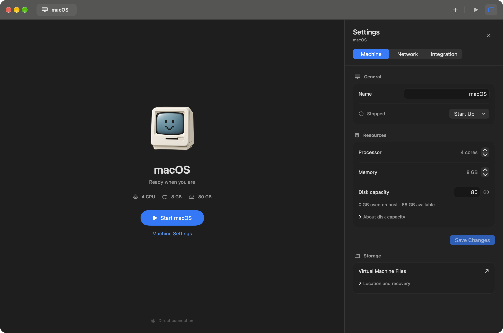
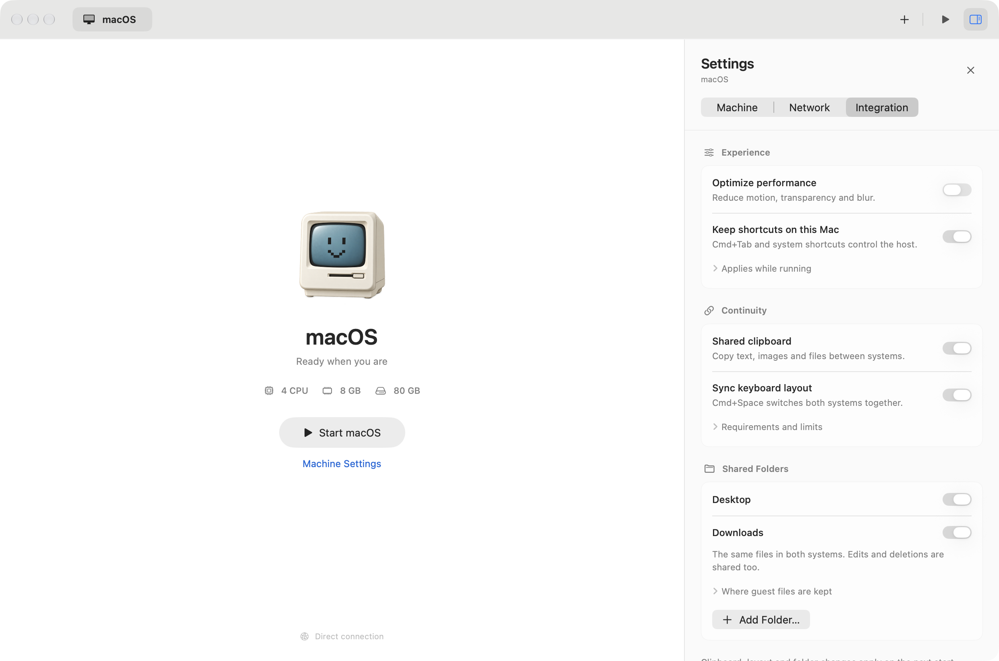

<p align="center"></p>
<h1 align="center">Isola</h1>
<p align="center"><strong>Лёгкое приложение на Swift для быстрого и удобного запуска виртуальной macOS.</strong></p>
<p align="center">Нативный интерфейс. Минимум лишнего. Ещё один Mac — в одном окне.</p>
<p align="center"><a href="https://github.com/itrcz/isola/releases/latest">Скачать</a> · <a href="../README.md">English</a> · <a href="../LICENSE">MIT</a></p>



Isola написана на **Swift и SwiftUI** и использует **Apple Virtualization framework**.
Для SOCKS-сети есть небольшой помощник на Go. Интерфейс полностью нативный, без
Electron и веб-оболочки.

## Возможности

| Функция | Что умеет |
| --- | --- |
| **Минималистичный интерфейс** | Вкладки машин, запуск в один клик, скрываемая панель настроек, светлая и тёмная темы. **⌘,** открывает настройки. |
| **Интернет напрямую или через прокси** | NAT хоста или SOCKS5. Исключения по IP, подсети и домену, например `*company.com`. |
| **Общий буфер обмена** | Текст, изображения и обычные файлы в обе стороны. |
| **Синхронизация языка** | Раскладка синхронизируется между системами. **⌘Space** в госте переключает обе. |
| **Общие Desktop и Downloads** | Привычные файлы доступны в обеих системах. Можно подключать другие папки, в том числе только для чтения. |
| **Оптимизация эффектов** | Меньше движения, прозрачности, размытия и анимаций. Отключение возвращает прежние настройки гостя. |
| **Настраиваемые ресурсы** | CPU, RAM и увеличение диска вместе с основным томом macOS. Перед расширением сохраняется резервная копия. |
| **Запуск в Recovery** | Встроен в меню запуска виртуальной машины. |



## Первый запуск

Нужен **Mac на Apple Silicon и macOS 14 или новее**. Intel и другие гостевые ОС
пока не поддерживаются. Для скачивания и установки macOS требуется от 45 ГБ
свободного места; фактический расход зависит от версии системы и файлов.

1. Скачай **ZIP для macOS arm64** из [Releases](https://github.com/itrcz/isola/releases/latest).
2. Распакуй и перенеси **Isola.app** в «Программы».
3. Выбери CPU, память, размер диска и режим сети: напрямую или через прокси.
4. Укажи `.ipsw` для Apple Silicon или скачай образ с серверов Apple прямо в Isola.
5. Установи macOS, запусти машину и пройди первоначальную настройку.
6. В гостевой macOS открой диск **Isola Tools** и запусти **Install Clipboard.command**.
   Это включает помощник для буфера, раскладки, папок и настройки эффектов.

Сборка подписана **ad-hoc**, без Developer ID и нотариализации Apple. Если macOS
блокирует первый запуск, воспользуйся кнопкой **«Всё равно открыть»** в настройках
«Конфиденциальность и безопасность» по [инструкции Apple](https://support.apple.com/ru-ru/102445).
В релизе есть `SHA256SUMS.txt` для проверки скачанного архива.

Для обновления штатно выключи гостевую macOS и закрой старую Isola, затем замени
приложение. Данные VM остаются в прежней папке. При обновлении гостевого помощника
повторно запусти его установщик с диска Isola Tools.

## Как это работает

**Сеть.** Прямой режим использует NAT Apple. SOCKS5 передаёт IPv4 TCP и DNS, без
прямого выхода при сбое прокси. Укажи числовой IP сервера; логин и пароль необязательны.
Пароль хранится в Связке ключей macOS. Правила обхода — по одному в строке:

```text
*company.com
10.0.0.0/8
203.0.113.5
```

Правило домена включает поддомены, но не `evilcompany.com`. Оно опирается на DNS
гостя: DoH/DoT обходят сопоставление, а общие IP CDN могут затронуть другие сайты.
В SOCKS-режиме нет общего UDP/QUIC и IPv6. Изменения сети применяются после перезапуска VM.

**Папки.** Desktop и Downloads включены по умолчанию. Изменения и удаления общие
для обеих систем. Прежние папки гостя сохраняются в
`~/Library/Application Support/Isola Integration/` и возвращаются после отключения
общего доступа и перезапуска гостя. Чужие символические ссылки не заменяются.
Дополнительные папки доступны в **Finder → My Shared Files**. Разреши доступ к
папкам при запросе macOS.

**Буфер и язык.** Текст и изображения — до 10 МиБ. Файлы — до 64 МиБ суммарно
и 128 файлов; папки, ссылки и file promises не передаются. Для синхронизации
раскладки тот же источник ввода должен быть доступен в госте.

**Диск.** Папка VM по умолчанию: `~/Library/Application Support/Isola/VM`.
Образ занимает место по мере записи. Увеличение требует APFS на хосте и поддерживаемой
разметки гостя. Isola сохраняет копию **Before expansion …**, переносит Recovery
и расширяет основной том. Отключать SIP или удалять Recovery не нужно. Для отката
выключи VM и добавь папку резервной копии как существующую машину.

**Эффекты.** Оптимизация меняет визуальные настройки гостя, а не выделение CPU/GPU.
Некоторым приложениям нужен перезапуск или повторный вход в гостевую учётную запись.
Одновременно работает одна VM. Язык интерфейса Isola берётся из настроек хоста:
русский или английский.

## Сборка из исходников

Нужны Apple Silicon, Xcode command line tools с SDK macOS 14+, [Go 1.27.1+](https://go.dev/dl/)
и Python 3 для тестов.

```sh
git clone https://github.com/itrcz/isola.git
cd isola
bash scripts/build.sh
open dist/Isola-0.5.0.app
```

Скрипт собирает приложение, сетевой и гостевой помощники, образ Isola Tools, иконку,
лицензионные уведомления и подпись. Xcode-проект и сторонние Swift-пакеты не нужны.

```sh
bash scripts/test.sh
bash scripts/test.sh --ui
bash scripts/test.sh --disk
bash scripts/release.sh
```

Тест диска требует APFS и Python 3.11+. Тесты используют временные данные. Упаковка
создаёт свежий ZIP и SHA-256 в `dist/release/` и проверяет подпись после распаковки.
Подробнее — в [CONTRIBUTING.md](../CONTRIBUTING.md).

## Лицензия

[MIT](../LICENSE). Лицензии зависимостей перечислены в
[THIRD_PARTY_NOTICES.md](../THIRD_PARTY_NOTICES.md) и входят в приложение.
Isola — независимый проект, не связанный с Apple. Образы macOS скачиваются у Apple
и не входят в репозиторий или релиз.
